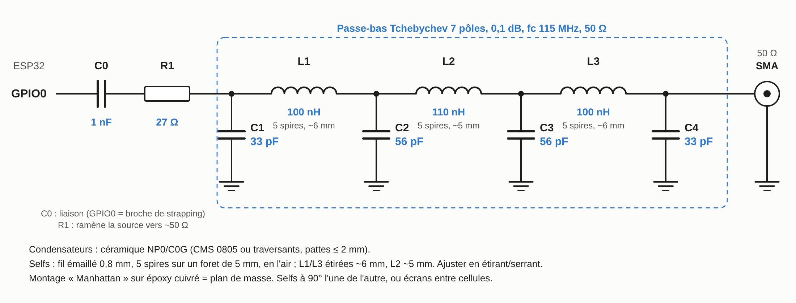
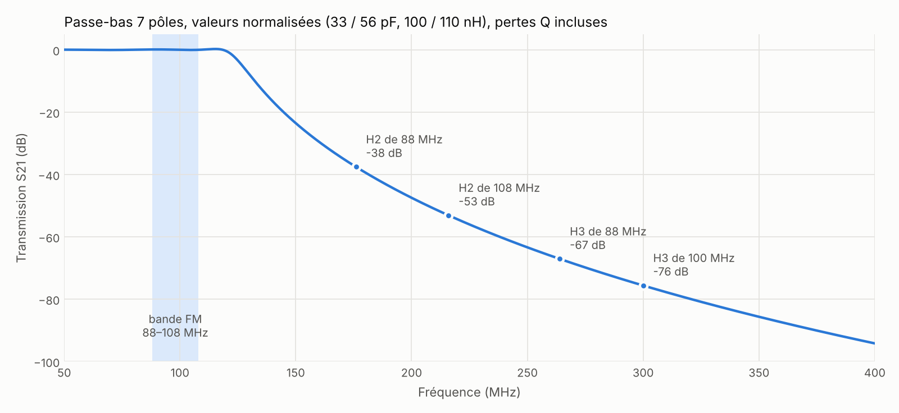

# AudioOutputFM

**Turn a bare ESP32 into a stereo FM broadcast transmitter with RDS, fed by a web radio. No RF chip, no DAC: the carrier comes straight out of GPIO0.**

AudioOutputFM is an output for Earle Philhower's [ESP8266Audio](https://github.com/earlephilhower/ESP8266Audio). It plugs in wherever `AudioOutputI2S` would. Instead of driving a DAC, it frequency-modulates the ESP32's audio PLL (APLL), whose clock is routed to GPIO0, anywhere between 88 and 108 MHz.

```cpp
#include "AudioOutputFM.h"

AudioOutputFM *out = new AudioOutputFM(100.1);   // MHz
mp3->begin(source, out);                         // tune any FM radio to 100.1 MHz
```

The `FMTransmitterWeb` example turns it into a complete appliance, configured from a browser:

- **Stations:** up to 8 web radio streams, in MP3 or AAC/HE-AAC, with the codec detected automatically.
- **Stereo and RDS:** stereo multiplex with RDS, showing the station name and the current song title on the receiver.
- **Control:** an On air / Off air switch, also usable from home automation.
- **Updates:** firmware upload over the air (OTA).
- **24/7 use:** self-healing (watchdogs, Wi-Fi recovery, heap guard).

All of this runs on a classic ESP32-WROOM-32 with no PSRAM.

> [!WARNING]
> **This is an experiment, not a product.** As with [rpitx](https://github.com/F5OEO/rpitx), the RF output is a raw square wave taken straight off a GPIO, and it is rich in harmonics. A low-pass filter is mandatory before anything resembling an antenna. Unlicensed transmission in the FM band is restricted or forbidden in most countries. Read [RF output and harmonics](#rf-output-and-harmonics) first.

---

## Contents

- [Features](#features)
- [Hardware](#hardware)
- [Getting started](#getting-started)
- [Examples](#examples)
- [The web transmitter (FMTransmitterWeb)](#the-web-transmitter-fmtransmitterweb)
- [Library API](#library-api)
- [How it works](#how-it-works)
- [Memory: fitting AAC, stereo and Wi-Fi in 320 KB](#memory-fitting-aac-stereo-and-wi-fi-in-320-kb)
- [RF output and harmonics](#rf-output-and-harmonics)
- [Validation status](#validation-status)
- [Limitations and known issues](#limitations-and-known-issues)
- [Going further: PSRAM](#going-further-psram)
- [Troubleshooting](#troubleshooting)
- [Credits and license](#credits-and-license)

---

## Features

| | |
|---|---|
| **Band** | 88–108 MHz, about 153 Hz tuning resolution. Two 160 kHz windows (around 90.0 and 100.0 MHz) are refused, [see why](#forbidden-frequencies) |
| **Modulation** | Wideband FM, 75 kHz deviation, pre-emphasis 50 µs (Europe) or 75 µs (Americas) |
| **Mono** | 15 kHz low-pass, slow AGC, peak limiter, noise-shaped quantization, at the source sample rate |
| **Stereo** | Full multiplex at 133.3 kHz: L+R, 19 kHz pilot, L−R on 38 kHz DSB-SC, with separation trims |
| **RDS** | 57 kHz, groups 0A (station name, PS) and 2A (RadioText). UTF-8 is converted to the RDS character set |
| **Sources** | Anything ESP8266Audio decodes. The web example handles MP3, AAC-LC and HE-AAC streams, with automatic detection |
| **Hardware** | Classic ESP32 (rev1 or later), GPIO0, plus a low-pass filter. Nothing else |

---

## Hardware

- **Board:** any classic ESP32 module (ESP32-WROOM-32, ESP32-WROVER, DevKitC and similar). The ESP32-S2, S3, C3 and later have no usable APLL output, and the library compiles to nothing on them.
- **Output:** GPIO0, through a series capacitor. GPIO0 is a boot strapping pin, and the capacitor stops the filter from pulling it low at reset.

```
GPIO0 ──┤├──[27 Ω]── 7-pole low-pass, fc ≈ 115 MHz ── dummy load or a few cm of wire
        1 nF
```

A filter with standard component values, its simulated response and build notes are in [Suggested output filter](#suggested-output-filter).

---

## Getting started

1. **Arduino-ESP32 core 3.3.x** (ESP-IDF 5.5). The library uses internal IDF APIs, so other major versions may not compile.
2. **ESP8266Audio** 1.9.0 or later, from the Library Manager.
3. **This library.** Use *Code → Download ZIP* on GitHub, then *Sketch → Include Library → Add .ZIP Library…*. You can also clone the repository into your `Arduino/libraries` folder.
4. **Board settings:**
   - **Board:** *ESP32 Dev Module* (or your module).
   - **Partition Scheme:** *Minimal SPIFFS (1.9MB APP with OTA)*. `FMTransmitterWeb` with AAC is about 1.29 MB, which fills 98 % of the default 1.25 MB app partition. With PSRAM enabled it no longer fits at all.
   - **CPU Frequency:** 240 MHz. The stereo loop is timed in CPU cycles.
5. **First test:** open `examples/ToneTest` and upload it. Tune a receiver to 100.1 MHz. You should hear a 1 kHz tone on the left channel, see a stereo indicator, and read "TONETEST" on an RDS receiver.

PlatformIO users need a platform that ships Arduino-ESP32 3.x, such as [pioarduino](https://github.com/pioarduino/platform-espressif32). A `library.json` is included.

---

## Examples

| Example | What it shows |
|---|---|
| [`ToneTest`](examples/ToneTest) | No Wi-Fi: stereo test tones (left, right, in or out of phase) and RDS. Use it for hardware bring-up and for tuning the stereo separation from the serial console |
| [`WebRadioFM`](examples/WebRadioFM) | Minimal web radio to FM, mono or stereo with RDS, written like ESP8266Audio's `StreamMP3FromHTTP`. Wi-Fi credentials go in the sketch; it has a serial console for live tuning |
| [`FMTransmitterWeb`](examples/FMTransmitterWeb) | The full appliance: web UI, NVS settings, stations, MP3/AAC, OTA, 24/7 operation. No credentials in the code |

---

## The web transmitter (FMTransmitterWeb)

### First boot

There are no credentials in the code. On first boot, the ESP32 opens the access point `ESP32-FM-Setup` (password `fmsetup123`). Join it, open `http://192.168.4.1`, and enter your Wi-Fi settings. After a restart, the page is at `http://fmtx.local`, or at the IP address printed on the serial port (115200 baud).

### The page

- **On air.** Shows the current song, the station, the actual frequency, mono/stereo/RDS, the codec, buffer and underruns, multiplex rate, RSSI with access point and channel, and free heap. It refreshes every 2 s. The big button switches the transmitter on or off air.
- **Stations.** Up to 8 names and URLs. The radio button puts a station on air immediately.
- **Transmitter.** Frequency, station name (PS), pre-emphasis, programme type, gain, and stereo/RDS/AGC switches.
  - Under *Advanced*: the stereo trims (`k`, phase), the RDS character set, and the RadioText A/B toggle.
  - Everything applies live, except switching mono/stereo, which restarts the ESP32.
- **System.** Uptime, last reset cause, lowest free heap, largest free block (current and lowest), available decoders, and firmware upload.
- **Wi-Fi.** SSID and password. They are stored in NVS and never echoed back.

All settings survive a reboot, including the on/off-air state.

### MP3 and AAC

The codec is detected from the stream itself, not from the URL or the HTTP headers:
1. The first 2 KB are scanned for two consecutive ADTS frame headers, the second one exactly where the first one says its frame ends. If found, the stream is AAC; otherwise it is MP3.
2. The bytes read for the check are replayed to the decoder through a small `PrefixSource` wrapper (`stream_sniff.h`), so nothing is lost.

Decoding uses ESP8266Audio's Helix decoders:
- **AAC-LC and HE-AAC v1 (SBR):** stereo.
- **HE-AAC v2 (parametric stereo):** comes out mono. Helix does not implement PS, so this mostly affects streams at 48 kb/s and below.
- **HLS (`.m3u8`) and MP4/fMP4 streams:** not supported.

Streams are opened in HTTP/1.0 (`useHTTP10()`, available since ESP8266Audio 1.9.0). Otherwise some servers answer HTTP/1.1 with chunked transfer encoding, and the chunk headers end up in the audio data, which sounds choppy and "accelerated".

### Running it 24/7

- **On air / Off air.** Use the button, or `POST /api/onair` with `on=1` or `on=0`. Off air:
  - stops the stream and the modulator, which frees core 1;
  - powers the APLL down and leaves GPIO0 high-impedance;
  - drops the CPU to 80 MHz and puts the Wi-Fi modem to sleep.
- **Self-healing:**
  - **Watchdog:** the audio and web tasks are watched; if either hangs for 30 s, the ESP32 reboots.
  - **Wi-Fi loss:** it reconnects every 30 s while down, and reboots after 10 minutes without Wi-Fi.
  - **Several access points with the same SSID** (repeaters, mesh): at connection, it scans every channel and joins the strongest access point, instead of the first one heard, which is the Arduino default. While connected, if the RSSI stays below −70 dBm, it looks for an access point at least 8 dB stronger and moves to it.
  - **Router slower to boot than the ESP32:** the setup access point runs alongside the station mode. While nobody is connected to it, the saved Wi-Fi is retried every 60 s. Once connected, the access point closes and the stream starts.
  - **Stalled stream:** if the modulator stays starved for 15 s, the stream is restarted from scratch.
  - **Heap guard:** the ESP32 reboots cleanly if internal RAM stays below 10 KB free, or its largest block below 2 KB, for 15 s in a row. Short dips caused by Wi-Fi and TCP bursts are normal and ignored.
- **OTA.** Upload the `.bin` from *Sketch → Export Compiled Binary* on the page. The transmitter goes off air for the update, then restarts in its saved state.

### HTTP API

| Endpoint | Parameters (form-encoded) | |
|---|---|---|
| `GET /api/state` | | All settings and live status as JSON (`status.onair`, `status.title`, `status.uptime`…) |
| `POST /api/onair` | `on=0\|1` | Go off or on air (saved) |
| `POST /api/select` | `i` | Put station *i* on air |
| `POST /api/stations` | `count`, `n0`…, `u0`… | Replace the station list |
| `POST /api/radio` | `freq`, `stereo`, `rds`, `agc`, `ps`, `pty`, `preemph`, `gain`, `k`, `h`, `charset`, `rtab` | Transmitter settings |
| `POST /api/wifi` | `ssid`, `pass` (empty keeps the current one) | Saves, then restarts |
| `POST /update` | multipart `firmware` | OTA firmware update |

Home Assistant (`configuration.yaml`):

```yaml
rest_command:
  fm_on:
    url: http://fmtx.local/api/onair
    method: POST
    payload: "on=1"
    content_type: application/x-www-form-urlencoded
  fm_off:
    url: http://fmtx.local/api/onair
    method: POST
    payload: "on=0"
    content_type: application/x-www-form-urlencoded
```

> [!CAUTION]
> The web interface has **no authentication**. Anyone on your network can change the settings or flash new firmware. Keep it on a trusted network, and change the setup access point password (`AP_PASS`) before deploying.

Serial console: `o 0|1` (off/on air), `x 0|1` (RF output only), `s` (status line).

---

## Library API

| Method | Purpose |
|---|---|
| `AudioOutputFM(float mhz = 100.1, int cpu = 1)` | Carrier frequency, and the core used by the modulator |
| `begin()` | Starts the carrier. Generators call it themselves; it is idempotent |
| `SetFrequency(mhz)` / `GetFrequency()` | Retune on the fly / frequency actually programmed (quantized to about 153 Hz) |
| `IsFrequencyUsable(mhz)` | Static check: band limits and [forbidden windows](#forbidden-frequencies) |
| `SetDeviation(hz)` | Full-scale deviation, default and maximum 75 kHz |
| `SetPreemphasis(us)` | 50 (Europe, default), 75 (Americas), 0 (off) |
| `SetAGC(on, rms = 0.25)` | Slow AGC, power averaged over about 3 s |
| `SetGain(f)` | 0–4, applied after the AGC |
| `SetDriveStrength(0..3)` | GPIO0 drive strength |
| `SetCarrier(on)` | RF on or off; the audio path keeps running |
| `SetBufferSize(n)` | Ring size in samples, before `begin()`. Mono default 4096; stereo uses 8192 |
| `stop()` | Called by generators at the end of a stream. **Keeps the carrier up** (silence), so receivers don't mute or seek |
| `end()` | Stops everything and releases the APLL. Buffers stay allocated, ready for `begin()` |
| `GetStats(reset = true)` | `rateHz`, `measuredHz`, `fill`/`size`, `underruns`, `isrMaxUs`, `isrLate`, `twoWritesPct`, `agcGain`, `peak`, `clips`, `stereo`, `isrPriority` |
| **Stereo** | |
| `SetStereo(on)` | Before `begin()`. The modulator then **owns its core** (see [Stereo](#stereo)) |
| `SetStereoTrim(k, deg)` | L−R gain and 38 kHz phase trim. Defaults 1.11 and −22°, measured on hardware |
| `SetPilotLevel(f)` | Pilot injection, default 0.09 |
| `SetPostedWrites(on)` | Mono only: don't wait for the internal bus after each write (always on in stereo) |
| **RDS** (stereo only) | |
| `SetRDS(on)` | Groups 0A and 2A on 57 kHz |
| `SetRdsPS(s)` | Station name, 8 characters |
| `SetRdsText(s)` | RadioText, up to 64 characters, UTF-8 or Latin-1. Thread-safe; an unchanged text is ignored |
| `SetRdsPI(pi)` / `SetRdsPTY(pty)` | Programme identification (default 0xF201) / programme type (default 10, pop) |
| `SetRdsLevel(f)` | Injection, default 0.04 |
| `SetRdsCharset(0\|1\|2)` | RDS table (IEC 62106 annex E, default), ASCII without accents, or raw Latin-1 for non-compliant receivers |
| `SetRdsABToggle(on)` | Flip the RadioText A/B flag on each new text. Off by default: some receivers (Yamaha RX-V673) then show the old and new titles alternately |

---

## How it works

### The APLL as an FM modulator

The ESP32's audio PLL, meant to clock I2S, outputs

```
f = f_xtal × (4 + sdm / 65536) / (2 × (o_div + 2))        sdm = sdm2:sdm1:sdm0 (22 bits)
```

The VCO must stay within 350–500 MHz. With `o_div = 0`, the output spans **87.5–125 MHz**, which covers the whole FM band, in steps of 40 MHz / 4 / 65536 = **152.6 Hz**. A ±75 kHz deviation is therefore ±491 steps.

`sdm` feeds the PLL's sigma-delta modulator, so a new value takes effect at once, with no relock. This is not documented and was confirmed on hardware. Rewriting it at the audio rate **is** frequency modulation. Rev0 silicon ignores `sdm0` and `sdm1`, so it cannot be used.

The `sdm` bytes are internal analog registers (`I2C_APLL_DSDM2/1/0`), reached over the chip's internal I2C bus ("regi2c"). The Wi-Fi PHY uses the same bus, under an IDF lock. The clock leaves on GPIO0 through `CLK_OUT1`, the path the Ethernet MAC uses for its 50 MHz RMII clock.

### Mono

```
ConsumeSample (generator task, float)                       Timer ISR @ sample rate (integer only)
  (L+R)/2 → 15 kHz low-pass (4th-order Butterworth)           pop q from the ring
  → slow AGC → gain → pre-emphasis                            sdm = center + q
  → peak limiter (instant attack, 150 ms release)             write DSDM1 if it changed, then DSDM0
  → × (deviation / 152.6 Hz) → round with 1st-order
    noise shaping → push to ring ──────────────────────────►
```

This is the same split as with a DAC: the generator does the floating-point work, and the interrupt plays the role of the I2S DMA engine. The 15 kHz low-pass keeps the 19 kHz pilot region empty, so receivers don't falsely switch to stereo. Noise shaping pushes the 152.6 Hz quantization noise toward high frequencies, where the receiver's de-emphasis removes it. One regi2c write costs about 3.4 µs, so the interrupt takes roughly 18 % of core 1 at 44.1 kHz.

### Stereo

A multiplex needs at least about 133 kHz. At that rate, one interrupt per sample would consume the whole core. So in stereo, the modulator is a **busy loop that owns core 1**, paced by the cycle counter: 1800 cycles at 240 MHz, giving exactly 133.333 kHz. If the loop falls behind, it drops overdue samples rather than slowing down. The decoder must therefore run on core 0, which all three examples do.

- **Resampler.** Polyphase, 256 phases × 32 taps, Kaiser-windowed sinc, with Q15 coefficients. It converts any source rate to 133.33 kHz and doubles as the 15 kHz low-pass: flat to about 14.5 kHz, −36 dB at 19 kHz, below −65 dB above 23 kHz. In simulation, images of the source rate stay around −80 dB and crosstalk at 1 kHz is −110 dB, before the APLL.
- **Multiplex.** A 32-bit NCO generates the 19 kHz pilot exactly. The 38 kHz subcarrier is twice the pilot phase plus a trim. The APLL loop shifts the subcarrier by about 20°, which would cap separation near 20 dB; a −22° trim, measured on a car radio, gives excellent separation.
- **Posted writes.** The ESP32 ROM's `rom_i2c_writeReg` was disassembled to recover the internal I2C master's register format. The loop then starts a write and returns at once, checking the "busy" flag only before the next write. This cuts the average cost from about 4.9 µs to about 1.3 µs, still under the IDF regi2c lock.
- **Flash writes.** The loop runs at `configMAX_PRIORITIES − 2`, one level below the IPC task, so flash operations (NVS saves, OTA) can still stall the core as the IDF requires. Expect a click of a few milliseconds on each save.

### RDS

- **Clocking.** The 57 kHz subcarrier is three times the pilot phase, and the bit clock is the pilot divided by 16 (1187.5 bit/s). Everything is locked to the pilot, as in a broadcast encoder.
- **Encoding.** Symbols are differentially encoded biphase, and the groups carry CRCs with offset words.
- **RadioText format.** RadioText is always sent as 64 space-padded characters with no 0x0D terminator. Some receivers display the terminator as `_` and keep stale segments of the previous text.
- **Text handling.** UTF-8 or Latin-1 input is converted to the RDS character set. In the examples, the ICY `StreamTitle` becomes the RadioText.

### Forbidden frequencies

DSDM2, DSDM1 and DSDM0 are written one after another. When the modulation carries across a multiple of 65536 steps, a DSDM2 change, the APLL briefly sees a value about **10 MHz** off, which sounds like heavy distortion. These boundaries fall every f_xtal/4 = 10 MHz. `IsFrequencyUsable()` therefore rejects anything within full deviation + 5 % of a boundary, which excludes **89.92–90.08** and **99.92–100.08 MHz**. That is why the default is 100.1 MHz.

The smaller DSDM1 carries, every 256 steps, are bounded by writing the high byte first.

---

## Memory: fitting AAC, stereo and Wi-Fi in 320 KB

The HE-AAC decoder needs about 88 KB in one contiguous block: Helix core 28 KB, SBR 50 KB, plus I/O buffers. After Wi-Fi starts, the ESP32 heap has about 197 KB free, but the largest block is only about 110 KB. Separate allocations for the decoder, the stream buffer and the modulator do not fit, because what's left is too fragmented. What made it work:

| Item | Size | Where | Why |
|---|---|---|---|
| **Arena** (decoder + stream buffer) | ~107 KB | the 110 KB boot block, allocated first | One block, carved per station once the codec is known: MP3 → 30 KB decoder + **79 KB** buffer; AAC → 88 KB decoder + **19 KB** buffer |
| Stereo ring | 16 KB | **IRAM** | Free IRAM (~37 KB) is unused by default. IRAM only allows 32-bit integer accesses, so the int16 ring is packed two samples per word behind `volatile` pointers, which keeps the compiler from narrowing them into 16-bit accesses (checked in the generated Xtensa code) |
| Resampler table | 8.3 KB | DRAM | Read 32 times per output sample, so it is kept out of IRAM. Stored in Q15: half the size of float, with the same response |
| Free after start | ~59 KB | | For Wi-Fi, TCP and the web server; largest block about 20 KB |

Lessons learned, useful beyond this project:
- **`ESP.getMaxAllocHeap()` counts IRAM.** It reports a block that no buffer can use. Use `heap_caps_get_largest_free_block(MALLOC_CAP_INTERNAL | MALLOC_CAP_8BIT)` instead.
- **IRAM rejects FPU loads and stores**, even aligned ones: `lsi`/`ssi` raise `LoadStoreError` there.

At 320 kb/s, a 19 KB AAC buffer covers only about 0.5 s, so prefer 64–128 kb/s AAC streams.

---

## RF output and harmonics

Read this before connecting an antenna.

- **It is a square wave.** GPIO0 toggles rail to rail. The odd harmonics are strong: 3rd at about −9.5 dBc, 5th at about −14 dBc. Duty-cycle asymmetry adds even harmonics, and the fast edges reach into the GHz range: 300 MHz falls in the military aviation UHF band, and the 24th harmonic of 100.1 MHz lands in Wi-Fi channel 1.
- **Filter it.** A 5- to 7-pole low-pass at about 110–115 MHz, in a 50 Ω path after the DC block. Without one, this is a broadband interference source.
- **Close-in purity is not characterized.** The APLL's sigma-delta, its loop and the register-write transients produce spurs and phase noise near the carrier that nobody has measured yet.
- **Power.** Up to about +10 dBm into 50 Ω before the filter. `SetDriveStrength(0)` lowers it. A dummy load and a receiver next to it are enough for experiments, and a receiver too close can overload, which sounds like distortion.
- **Regulations.** Unlicensed FM-band transmitters are limited to nanowatts or forbidden in most countries. The FM broadcast band is not an amateur allocation.

### Suggested output filter

A 7-pole Chebyshev low-pass (0.1 dB ripple, fc 115 MHz, 50 Ω) using standard values: 33 pF / 100 nH / 56 pF / 110 nH / 56 pF / 100 nH / 33 pF. In front of it, a 1 nF DC block and 27 Ω in series bring the GPIO close to 50 Ω.



Simulated with realistic losses (Q 150 coils, Q 500 capacitors):
- **Passband:** flat across 88–108 MHz (return loss ≥ 13.5 dB).
- **Stopband:** −38 dB at 176 MHz, −67 dB at 264 MHz, −76 dB at 300 MHz.

In practice, layout limits the deep stopband to about −50 to −60 dB.



- **Capacitors:** NP0/C0G only (0805, or leaded with leads of 2 mm or less).
- **Coils:** air-wound, 0.8 mm enamelled wire, 5 turns on a 5 mm drill bit. Stretch L1/L3 to about 6 mm (≈ 100 nH) and L2 to about 5 mm (≈ 110 nH). Tune with a NanoVNA for a flat passband to 108 MHz.
- **Construction:** Manhattan style on copper-clad board, with short grounds, coils at 90° to each other, and SMA connectors.

---

## Validation status

Tested on an ESP32-WROOM-32 (no PSRAM), Arduino-ESP32 3.3.5, carrier 100.1 MHz:

| | Status |
|---|---|
| Mono, 256 kb/s MP3 | ✅ Very good on a car radio and a portable receiver |
| Stereo separation | ✅ Excellent with `k = 1.11`, `h = −22°` (car radio) |
| RDS PS and RadioText | ✅ Kenwood car radio, Yamaha RX-V673 |
| MP3 and AAC streams, station switching | ✅ Smooth, no dropouts (MP3 256 kb/s, AAC-LC 320 kb/s) |
| Multiplex rate under Wi-Fi load | ✅ 133 332 Hz |
| On/off air, OTA, setup AP retry, AP roaming | ⚠️ Implemented; partially exercised |
| PSRAM boards (arena in PSRAM) | ⚠️ Compiles; not tested on hardware |
| RF spectrum, spurs, harmonics after the filter | ❌ Not measured |

---

## Limitations and known issues

- **Classic ESP32 only**, rev1 or later, and GPIO0 only.
- **The APLL is exclusive.** Don't combine this with I2S in APLL mode, or with Ethernet RMII using an internal clock.
- **Internal IDF APIs** (`esp_private/regi2c_ctrl.h`, undocumented APLL registers, the ROM bus format). A future ESP-IDF release may break them.
- **Mono-mode interrupt peaks.** The typical interrupt takes about 4 µs, but the worst case reaches 50–60 µs. The likely cause is waiting for the regi2c lock while the Wi-Fi PHY calibrates. It is inaudible, and `GetStats()` reports it (`isrMaxUs`, `isrLate`). Stereo mode uses posted writes and drops late samples instead, so it degrades differently.
- **HE-AAC v2 plays in mono.** HLS and MP4 streams are not supported.
- **Flash.** `FMTransmitterWeb` needs the *Minimal SPIFFS* partition scheme (see [Getting started](#getting-started)).

---

## Going further: PSRAM

PSRAM removes the memory squeeze entirely. The decoder and a large stream buffer move out of the internal heap, and even 320 kb/s AAC gets seconds of buffering.

- **Easiest:** use an **ESP32-WROVER** module, or a DevKit built on one. It is the same chip and pin-compatible, except that GPIO16/17 are taken by the PSRAM. Enable *PSRAM* in the board settings. `FMTransmitterWeb` detects it and puts a 256 KB arena there. This path compiles but is untested on hardware.
- **Soldering a PSRAM chip onto a WROOM** (an ESP-PSRAM64H piggybacked on the flash chip under the shield, with CS on GPIO16 and CLK on GPIO17) is a known hack, but it means opening the RF can and hand-wiring an 80 MHz bus. Replacing the module is simpler.
- **A separate SPI SRAM** (23LC1024, with ESP8266Audio's `AudioFileSourceSPIRAMBuffer`) can hold a large stream buffer on ordinary SPI pins. It cannot hold the decoder, so it only helps the buffer side.

Caveats with PSRAM on the classic ESP32:
- The compiler workaround for the rev1 PSRAM cache bug makes all code a little slower.
- PSRAM is unavailable during flash writes, like code in flash.

The modulator keeps its buffers in internal RAM and IRAM, so neither caveat touches the real-time loop.

---

## Troubleshooting

| Symptom | Likely cause |
|---|---|
| `begin()` returns false | Frequency outside 88–108 MHz or in a forbidden window; APLL already in use; rev0 chip; no RAM for the ring |
| Boot loop after wiring | Something pulls GPIO0 low at reset: add or check the series capacitor |
| Harsh periodic distortion | Receiver overloaded (move it away, `SetDriveStrength(0)`), or a modified build using a forbidden frequency |
| Poor stereo separation | Run `ToneTest` with a left-only tone and adjust `h` (phase) first, then `k` |
| Choppy, "accelerated" sound on one station | Chunked HTTP/1.1 transfer: open the stream with `useHTTP10()` before `open()` (the examples do) |
| `underruns` rising | Stream not arriving fast enough: check RSSI, prefer a lower bitrate (AAC especially) |
| `Decoders: MP3 only` on the serial port | Not enough contiguous RAM for HE-AAC: something else allocated a large block before the arena |
| `Guru Meditation … LoadStoreError` | A non-32-bit access to IRAM: see [Memory](#memory-fitting-aac-stereo-and-wi-fi-in-320-kb) |
| Sketch too big | Select the *Minimal SPIFFS* partition scheme |

---

## Credits and license

- **Code, design and documentation:** written by [Claude](https://claude.ai) (Anthropic's AI model) over a series of interactive sessions.
- **Idea, hardware, testing, measurements and debugging:** Seb. Every step was validated on real hardware and receivers by him.
- Built on [ESP8266Audio](https://github.com/earlephilhower/ESP8266Audio) by Earle F. Philhower III, and its Helix MP3/AAC decoders.
- Inspired by [rpitx](https://github.com/F5OEO/rpitx) and the long tradition of making clock outputs do things they were never meant to.

Licensed under the **GNU General Public License v3.0 or later** (see [LICENSE](LICENSE)), the same as ESP8266Audio.
